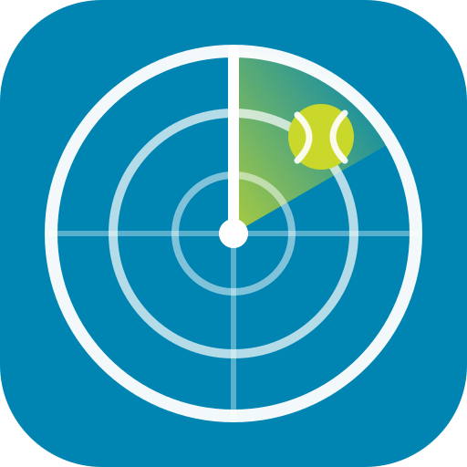

# Padel Radar

A faster, friendlier front end for [Sporty.plus](https://sporty.plus) court booking. See a whole week of courts at once, with league matches, results and open slots, and book a court in two clicks.

**Live:** https://saler-luka.github.io/padel-radar/

## What it does

- **Week board.** Every day and court on one screen. League matches show team names and scores, and free courts are highlighted in green with their price.
- **Booking.** Log in with your Sporty.plus email and password (two-step codes are supported) and book any free slot for yourself.
- **Results.** Recent club results with sets, rounds and winners.
- **Fast.** Weeks are cached and prefetched, and the last week you saw opens instantly.
- **Light and dark themes**, plus a day-by-day layout on phones.

It's a single static `index.html` with no build step and no backend. It talks directly to the Sporty.plus API from your browser.

## Using it for another club

Open **Settings** and enter the club's ID and web address (the `modesto` in `modesto.sporty.plus`). The default is Modesto (club 139).

## Privacy

Your password goes straight from your browser to Sporty.plus and is never stored. Only the session token Sporty.plus returns is kept, in your browser's local storage. **Log out** ends that session.

## Running locally

Open `index.html` in a browser, or serve the folder with any static server.

## Disclaimer

This is an unofficial project and isn't affiliated with Sporty.plus. It uses the same private API as the official app, which can change without notice.
